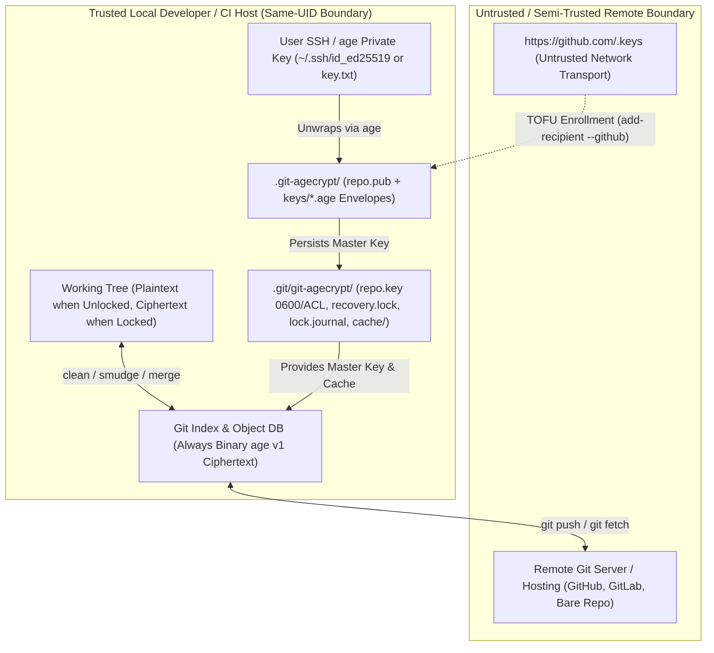
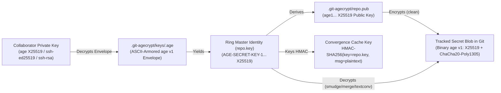
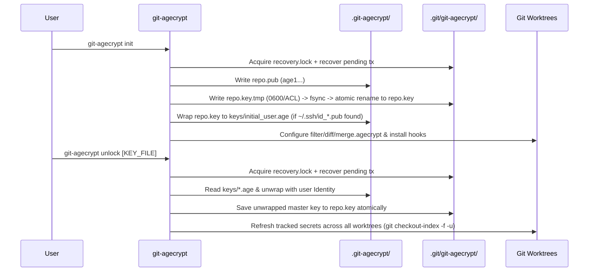
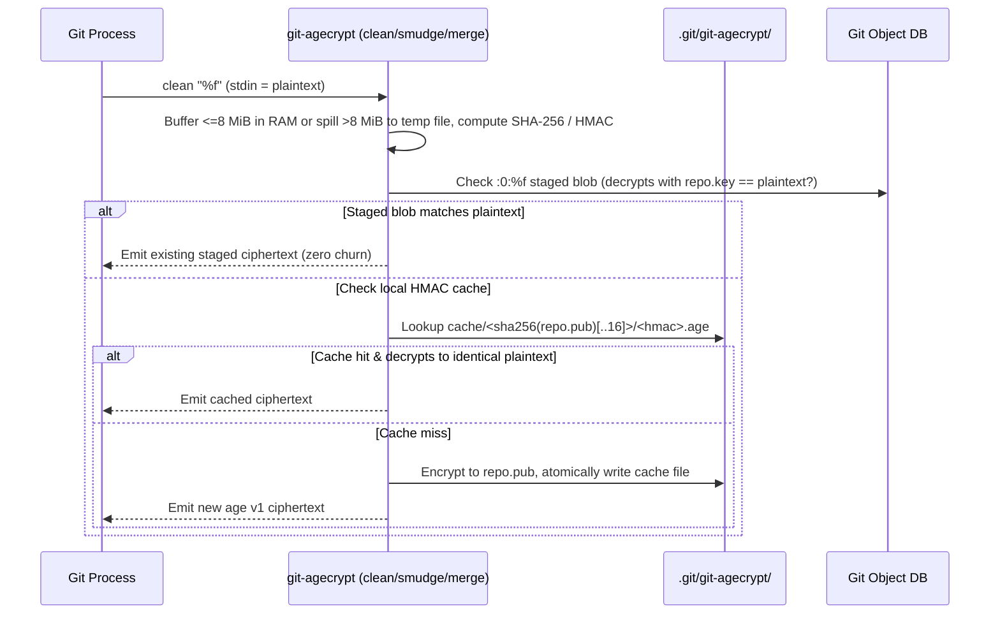
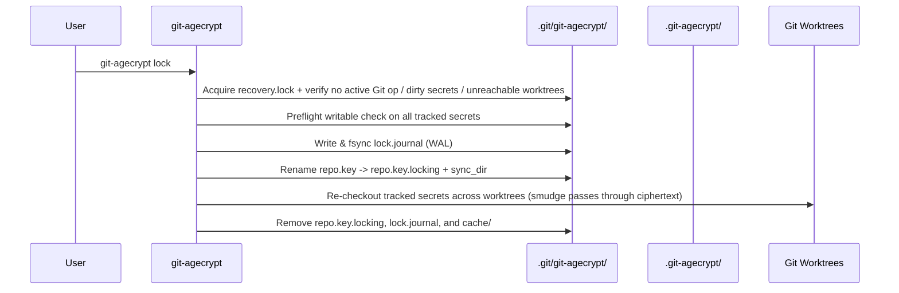

# `git-agecrypt` External Security Review Readiness Package

**Scope:** Threat model, cryptographic architecture, data-flow diagrams, complete `unsafe` and OS syscall inventory, dependency rationale, crash/durability model, concurrency/locking model, and reviewer focus areas.

> [!NOTE]
> `git-agecrypt` has not yet undergone a paid third-party cryptographic audit. This package provides a complete, self-contained technical reference for internal security reviewers, enterprise adopters, and external cryptographic auditors.

---

## 1. System Overview and Trust Boundaries

`git-agecrypt` is a client-side Git filter, diff, and 3-way merge driver accompanied by client and server policy verification commands (`check`, `inspect`, `export-age`).

### Trust Assumptions
1. **Remote Git Server (Untrusted for Confidentiality):** Receives only binary `age` v1 ciphertexts, public X25519 keys (`repo.pub`), and ASCII-armored `age` recipient envelopes (`keys/*.age`). Never receives `repo.key`, user private keys, or HMAC cache filenames.
2. **Local Host OS & Same-UID Boundary:** The local kernel and processes running under the developer's UID are trusted during unlocked editing, except where explicitly hardened:
   - Other local UIDs are blocked via `0700` directory / `0600` file modes on Unix and explicit `icacls /inheritance:r /grant:r <USERNAME>:(R,W)` ACLs on Windows.
   - Under `git-agecrypt run --fd` on Linux, same-UID unprivileged process inspection (`/proc/<pid>/fd`, `ptrace`) is mitigated via `prctl(PR_SET_DUMPABLE, 0)` before fork and in `pre_exec`.
3. **Git Attributes & Repository Metadata Integrity:** `.gitattributes` and `.git-agecrypt/` are tracked in Git. To defend against malicious repository changes (e.g., removing filter rules, renaming secrets to unprotected paths, or injecting shell metacharacters into filenames), `git-agecrypt check` (client hooks) and `git-agecrypt check --pre-receive` / `--commit-range` (server/CI enforcement) validate paths, headers, and metadata.

---

## 2. Cryptographic Architecture and Key Hierarchy

- **No Custom Cryptography:** All encryption and decryption are delegated to the upstream `age` crate (`X25519`, `HKDF-SHA256`, `ChaCha20-Poly1305` STREAM construction).
- **Per-Ring Key Isolation:** Each ring (`default` or `.git-agecrypt/rings/<ring>/`) generates an independent 256-bit `age::x25519::Identity`.
- **Memory Zeroization:** Unwrapped master key strings and export buffers are wrapped in `zeroize::Zeroizing<String>` / `Zeroizing<Vec<u8>>` and `age::secrecy::SecretString`.

---

## 3. Data-Flow Diagrams for Core Operations

### 3.1 `init`, `add-recipient`, and `unlock`

### 3.2 `clean`, `smudge`, and `merge`

### 3.3 `rekey`, `rewrap`, and `lock`

---

## 4. Complete Inventory of `unsafe` Blocks and OS Syscalls

Every `unsafe` block in the workspace is restricted to OS process/file primitives in `src/git.rs` and `src/main.rs`. Zero `unsafe` blocks exist in `src/crypto.rs`, `src/format.rs`, `src/merge.rs`, `src/shield.rs`, `src/github.rs`, or `src/cli.rs`.

| File & Location | Platform | Syscall / FFI API | Purpose | Safety Invariants & Failure Handling |
| :--- | :--- | :--- | :--- | :--- |
| [`src/git.rs` (`crash_point`)](file:///C:/Users/leonz/Desktop/git-agecrypt/src/git.rs#L65-L95) | Unix / Windows | `libc::raise(SIGKILL)` / `TerminateProcess(GetCurrentProcess(), 137)` | Deterministic crash injection for test suite (`test_crash_matrix.rs`). | Gated behind **both** `GIT_AGECRYPT_CRASH_HOOKS_ARMED=1` AND `GIT_AGECRYPT_CRASH_POINT=<name>`. Never active in normal execution. |
| [`src/git.rs` (`open_pinned_secret_file`)](file:///C:/Users/leonz/Desktop/git-agecrypt/src/git.rs#L102-L125) | Unix | `libc::openat`, `libc::close`, `File::from_raw_fd` | Opens secret/lock files relative to an open directory FD with `O_RDWR \| O_CLOEXEC \| O_NOFOLLOW` (and `O_CREAT \| O_EXCL` for temp keys) with mode `0600`. | `c_name` is validated by `CString::new` (no interior NUL). `dir_fd` is always closed before checking `fd < 0`. `File::from_raw_fd` is only called when `fd >= 0`. |
| [`src/git.rs` (`is_pid_alive`)](file:///C:/Users/leonz/Desktop/git-agecrypt/src/git.rs#L245-L295) | Windows / Unix | `OpenProcess`, `GetExitCodeProcess`, `CloseHandle`, `GetLastError` / `libc::kill(pid, 0)` | Checks liveness of the PID recorded in auxiliary `refresh.lock`. | On Windows, `CloseHandle` is always called on non-null handles; `ERROR_ACCESS_DENIED` is treated as alive. Never used on `recovery.lock`. |
| [`src/git.rs` (`save_local_master_key_for_ring`)](file:///C:/Users/leonz/Desktop/git-agecrypt/src/git.rs#L645-L685) | Windows | `MoveFileExW(..., MOVEFILE_REPLACE_EXISTING \| MOVEFILE_WRITE_THROUGH)` | Atomic replacement of `repo.key` from ACL-restricted temp file on NTFS. | UTF-16 paths are explicitly NUL-terminated (`chain(Some(0))`). Retries up to 5 times; on failure, preserves existing `repo.key` and returns error. |
| [`src/main.rs` (`main`)](file:///C:/Users/leonz/Desktop/git-agecrypt/src/main.rs#L68-L75) | Linux | `libc::prctl(PR_SET_DUMPABLE, 0)` | Restores non-dumpability in child `git-agecrypt` processes when `GIT_AGECRYPT_RUN_NON_DUMPABLE` is set. | Pure process-attribute syscall with integer constants; takes no pointers. |
| [`src/main.rs` (`cmd_test_dumpable`)](file:///C:/Users/leonz/Desktop/git-agecrypt/src/main.rs#L1230-L1245) | Linux | `libc::prctl(PR_GET_DUMPABLE)` | Hidden test probe (`__test-dumpable`) verifying `PR_SET_DUMPABLE == 0` inheritance in security tests. | Checks `dumpable < 0` for OS errors; takes no pointers. |
| [`src/main.rs` (`pass_via_memfd`)](file:///C:/Users/leonz/Desktop/git-agecrypt/src/main.rs#L1270-L1335) | Linux | `syscall(SYS_memfd_create, ..., MFD_CLOEXEC)`, `File::from_raw_fd`, `prctl(PR_SET_DUMPABLE, 0)`, `CommandExt::pre_exec` (`fcntl`), `libc::close` | Creates an anonymous in-memory file descriptor for `git-agecrypt run --fd`, clears `FD_CLOEXEC` only for the target FD in the child before `exec`, and disables core dumps / ptrace. | `fd < 0` is checked before `File::from_raw_fd`. `pre_exec` closure executes only async-signal-safe `fcntl` and `prctl` calls without heap allocation. |

---

## 5. Dependency Rationale

| Crate | Version | Security & Architectural Role |
| :--- | :--- | :--- |
| `age` | `0.11` (`armor`, `ssh`) | Core cryptographic implementation of the age v1 specification (`X25519`, `ssh-ed25519`, `ssh-rsa`, `ChaCha20-Poly1305` STREAM, ASCII armor). |
| `zeroize` | `1.8` | Deterministic memory scrubbing (`Zeroizing<T>`) for unwrapped master keys and decrypted secret buffers on drop. |
| `sha2` | `0.10` | RustCrypto SHA-256 for cache namespace derivation (`SHA256(repo.pub)`) and streaming plaintext hashing. |
| `hmac` | `0.12` | RustCrypto HMAC-SHA256 keyed by `repo.key` for convergence cache filenames (prevents offline plaintext dictionary attacks against `.git/git-agecrypt/cache/`). |
| `fs2` | `0.4` | Cross-platform OS-level file locking (`flock` on Unix, `LockFileEx` on Windows) for `recovery.lock`. |
| `tempfile` | `3.15` | Secure `O_EXCL` temporary file creation for streaming spools (`>8 MiB`) and same-filesystem atomic persistence. |
| `ureq` | `3.0` (`rustls`) | Memory-safe TLS HTTP client (using `rustls`, no OpenSSL) solely for `add-recipient --github <user>`. |
| `libc` | `0.2` | POSIX syscall bindings (`openat`, `fcntl`, `prctl`, `SYS_memfd_create`). |
| `rpassword` | `7.3` | Terminal echo suppression when prompting for passphrase-protected SSH/age keys on `/dev/tty` or `CONIN$`. |
| `ctrlc` | `3.4` | Clean `SIGINT`/`Ctrl+C` exit handler (`exit(130)`), delegating rollback to startup WAL recovery. |
| `clap` / `anyhow` / `glob` / `dirs` / `hex` | Standard | CLI argument parsing, error context propagation, `.gitattributes` glob matching, home directory lookup, and hex encoding. |

---

## 6. Crash and Durability Model

1. **Master Key Write Durability (`save_local_master_key_for_ring`):**
   - Writes to `repo.key.tmp.<pid>.<nonce>` with mode `0600` / restricted ACL established prior to writing key bytes.
   - Calls `File::sync_all()`, then atomically renames over `repo.key` (`rename` / `MoveFileExW` with `MOVEFILE_WRITE_THROUGH`), followed by `sync_dir` on the parent directory.
   - Tested at 4 deterministic crash points (`after_tmp_create`, `after_plaintext_write`, `after_key_rename`, `after_dir_fsync`).
2. **Lock Transaction Durability (`transactional_lock_for_ring`):**
   - Records all target `<worktree>\t<rel_path>` entries into `lock.journal`, calls `sync_all()` + `sync_dir()`.
   - Renames `repo.key` -> `repo.key.locking` + `sync_dir()`.
   - Refreshes worktrees.
   - On completion, removes `repo.key.locking` and `lock.journal`.
   - On crash at any point (`before_tx_begin`, `after_journal_create`, `after_journal_transition`, `after_journal_fsync`, `after_key_rename`, `after_dir_fsync`, `before_cleanup`, `after_cleanup`), the next command's `acquire_recovery_lock()` atomically restores `repo.key` from `repo.key.locking` and replays `lock.journal` without overwriting uncommitted user plaintext edits.

---

## 7. Concurrency and Locking Model

1. **Primary Coordinator (`recovery.lock`):**
   - Located at `<git-common-dir>/git-agecrypt/recovery.lock`.
   - Acquired via `GitRepo::acquire_recovery_lock()`, which uses bounded retries (`DEFAULT_RECOVERY_LOCK_TIMEOUT_MS = 30_000`, configurable via `GIT_AGECRYPT_LOCK_TIMEOUT_MS`), rejects symlinks/reparse points, disables `FILE_SHARE_DELETE` on Windows, verifies `(st_dev, st_ino)` path identity on Unix after lock acquisition, and executes `recover_interrupted_transaction_locked()` under the same held lock guard before returning to the caller.
   - Held continuously across `init`, `add-recipient`, `remove-recipient`, `rekey`, `rewrap`, `unlock`, `lock`, `migrate-from-git-crypt`, `shield`, and `install-hooks`, as well as during `save_local_master_key_for_ring` in background `smudge` auto-refresh.
2. **Auxiliary Filter Refresh Coordinator (`refresh.lock`):**
   - Located at `<state_dir>/refresh.lock`.
   - Used by parallel `smudge` filter workers when an upstream `rekey` is detected (`repo.pub` does not match `repo.key`) so only one worker unwraps `keys/*.age` while sibling workers wait and adopt the refreshed key.
   - Actual replacement of `repo.key` inside `try_auto_refresh_master_key_for_ring` still acquires `recovery.lock`.
3. **Git Index Lock (`index.lock`):**
   - Managed by Git subcommands (`git add`, `git checkout-index`, `git update-index`); `run_git_cmd_with_index_retry` applies bounded backoff on transient `index.lock` contention.

---

## 8. Priority Questions and Focus Areas for Security Reviewers

External auditors and reviewers are encouraged to prioritize the following high-impact areas:
1. **Cross-Platform Atomic File Replacement & Permissions (`src/git.rs`):** Verify that `open_pinned_secret_file` and `save_local_master_key_for_ring` leave no window on Linux, macOS, or Windows where `repo.key.tmp.*` or `merge-spool` files are readable by another local user or redirectable via symlink/junction swaps.
2. **Transactional Lock Journal & Worktree Recovery (`src/git.rs`, `src/format.rs`):** Verify that no sequence of crashes during `lock`, `unlock`, or `rekey` across multiple linked worktrees can either (a) destroy uncommitted plaintext edits in a worktree or (b) leave a worktree with raw ciphertext while reporting the repository as unlocked.
3. **Git Filter Command-Line & Attribute Injection (`src/git.rs`, `src/format.rs`):** Verify that `is_shell_safe_repo_path`, `validate_ring_name`, and `FORBIDDEN_ENV_VARS` block all avenues for a malicious repository commit to achieve code execution during `git checkout`, `git merge`, or `git-agecrypt run`.
4. **Server-Side Pre-Receive & Bare-Repository Verification (`src/format.rs`):** Verify that `check_pre_receive_lines` cannot be bypassed via multi-ref pushes, annotated tags, rename diffs, or malformed `age` headers.
